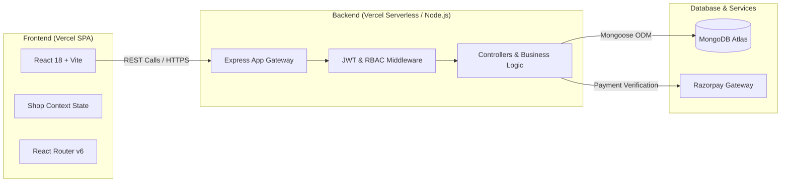

# 👗 STYLEHUB — Modern Full-Stack Fashion E-Commerce Platform

[](https://stylehub-dress.vercel.app/)
[](https://stylehub-backend-muzzu4845-gifs-projects.vercel.app/)
[](https://react.dev/)
[](https://vitejs.dev/)
[](https://nodejs.org/)
[](https://expressjs.com/)
[](https://www.mongodb.com/atlas)

A production-ready, full-stack MERN (MongoDB, Express, React, Node.js) fashion e-commerce web application featuring high-performance catalog browsing, persistent shopping cart and wishlist management, Razorpay payment gateway integration, comprehensive order tracking, and an administrative analytics dashboard.

---

## 🌐 Live Deployments

| Component | Platform | Live URL | Status |
| :--- | :--- | :--- | :--- |
| **Storefront (Frontend)** | Vercel | [https://stylehub-dress.vercel.app/](https://stylehub-dress.vercel.app/) |  |
| **API Gateway (Backend)** | Vercel Serverless | [https://stylehub-backend-muzzu4845-gifs-projects.vercel.app/](https://stylehub-backend-muzzu4845-gifs-projects.vercel.app/) |  |
| **API Health Check** | Vercel Serverless | [https://stylehub-backend-muzzu4845-gifs-projects.vercel.app/api/health](https://stylehub-backend-muzzu4845-gifs-projects.vercel.app/api/health) |  |
| **GitHub Repository** | GitHub | [https://github.com/muzzu4845-gif/Dress](https://github.com/muzzu4845-gif/Dress) |  |

---

## 🚀 Key Features

### 🛍️ Client & Storefront Experience
- **Responsive UI/UX:** Built with mobile-first design principles, fluid animations, and a modern luxury fashion aesthetic.
- **Product Filtering & Search:** Real-time multi-criteria filtering by category (Men, Women, Accessories), price range, ratings, and keyword search.
- **Interactive Product Showcase:** Product image carousels, size selection, stock level indicators, and detailed apparel specifications.
- **Persistent Cart & Wishlist:** Client-side local storage persistence with automatic synchronization to MongoDB upon user login.
- **Checkout & Payments:** Seamless checkout flow supporting both **Razorpay Payment Gateway** and **Cash on Delivery (COD)** with automatic order generation.
- **User Dashboard & Order History:** Detailed order status tracking (`Pending`, `Processing`, `Shipped`, `Delivered`), itemized invoices, and delivery addresses.

### 🛡️ Backend & Security Architecture
- **Stateless Authentication:** JSON Web Token (JWT) with bearer token verification and bcrypt password hashing.
- **Role-Based Access Control (RBAC):** Granular middleware separating public routes, customer routes, and admin-only management endpoints.
- **Rate Limiting & Protection:** Brute-force protection on authentication endpoints using `express-rate-limit`.
- **Cloud-Ready Serverless Deployment:** Optimized for Vercel Serverless Functions with cached MongoDB connection pooling and safe DNS fallback.
- **Input Validation & Centralized Error Handling:** Uniform API response envelope and robust error interception.

### 📊 Administrative Suite
- **Analytics Dashboard:** Overview of total revenue, orders count, customer registrations, and recent transaction history.
- **Inventory Management:** Low-stock threshold alerts and full product CRUD controls.

---

## 🏗️ Architecture & Technology Stack



### Technology Breakdown
- **Frontend:** React 18, Vite, React Router DOM 6, Lucide React (Icons), CSS3 / Flexbox / Grid.
- **Backend:** Node.js, Express.js (ES Modules), Mongoose ODM, Razorpay SDK, JSON Web Token (JWT), bcryptjs, CORS, express-rate-limit.
- **Database:** MongoDB Atlas (Cloud Cluster).
- **Deployment & Hosting:** Vercel (Frontend SPA + Backend Serverless Functions).

---

## 📂 Repository Structure

```text
Dress/
├── .gitignore               # Ignored files (node_modules, .env, build outputs)
├── package.json             # Root monorepo orchestration scripts
├── render.yaml              # Alternative Render PaaS deployment blueprint
├── README.md                # Project documentation
│
├── backend/                 # Node.js / Express REST API
│   ├── api/
│   │   └── index.js         # Vercel Serverless entrypoint
│   ├── config/
│   │   └── db.js            # MongoDB connection pooling & DNS configuration
│   ├── controllers/         # Request handling & business logic
│   │   ├── authController.js
│   │   ├── cartController.js
│   │   ├── orderController.js
│   │   ├── productController.js
│   │   └── userController.js
│   ├── middleware/          # JWT auth & centralized error middleware
│   │   ├── authMiddleware.js
│   │   └── errorMiddleware.js
│   ├── models/              # Mongoose schemas & data models
│   │   ├── Order.js
│   │   ├── Product.js
│   │   └── User.js
│   ├── routes/              # Express API route declarations
│   ├── utils/               # JWT token generators & helper utilities
│   ├── .env.example         # Template for backend environment variables
│   ├── package.json         # Backend dependencies & scripts
│   ├── seeder.js            # Database seeding script for catalog & demo users
│   ├── server.js            # Main Express application definition
│   ├── test-api.js          # Automated end-to-end API integration tests
│   └── vercel.json          # Backend Vercel serverless routing config
│
└── frontend/                # React / Vite Client Application
    ├── public/              # Static public assets
    ├── src/
    │   ├── assets/          # SVG logos and vector graphics
    │   ├── components/      # Reusable UI components (Navbar, CartDrawer, etc.)
    │   ├── context/         # ShopContext (Cart, Wishlist, Auth state management)
    │   ├── data/            # Static fallback product catalog
    │   ├── pages/           # Application views (Home, Shop, Cart, Admin, etc.)
    │   ├── services/        # Fetch API client and service layer
    │   └── styles/          # Responsive component stylesheets
    ├── index.html           # HTML entry document
    ├── package.json         # Frontend dependencies & build scripts
    ├── vercel.json          # Frontend SPA routing rewrite configuration
    └── vite.config.js       # Vite configuration
```

---

## 📡 REST API Reference

All endpoints are prefixed with `/api`.

| Method | Endpoint | Access | Description |
| :--- | :--- | :--- | :--- |
| **GET** | `/api/health` | Public | Health status & uptime verification |
| **POST** | `/api/auth/register` | Public | Register a new customer account |
| **POST** | `/api/auth/login` | Public | Authenticate user & receive JWT token |
| **GET** | `/api/auth/profile` | Private | Retrieve authenticated user profile |
| **PUT** | `/api/auth/profile` | Private | Update user profile details |
| **GET** | `/api/products` | Public | Fetch products with pagination & filtering |
| **GET** | `/api/products/:id` | Public | Get single product by MongoDB ID |
| **POST** | `/api/products` | Admin | Create a new catalog item |
| **PUT** | `/api/products/:id` | Admin | Update existing product details |
| **DELETE**| `/api/products/:id` | Admin | Remove product from catalog |
| **GET** | `/api/cart` | Private | Get synchronized user cart |
| **POST** | `/api/cart` | Private | Add item to user cart |
| **DELETE**| `/api/cart/:productId` | Private | Remove item from cart |
| **POST** | `/api/orders` | Private | Create new order (Razorpay / COD) |
| **GET** | `/api/orders/myorders` | Private | List all orders placed by the current user |
| **GET** | `/api/users/stats` | Admin | Retrieve sales metrics and inventory stats |

---

## 🛠️ Local Development Quickstart

### Prerequisites
- [Node.js](https://nodejs.org/) (version 18.0.0 or higher)
- [Git](https://git-scm.com/)
- [MongoDB Atlas](https://www.mongodb.com/atlas) connection URI (or local MongoDB daemon)

### 1. Clone the Repository
```bash
git clone https://github.com/muzzu4845-gif/Dress.git
cd Dress
```

### 2. Configure Backend Environment
Navigate to `backend/` and configure your environment variables:
```bash
cd backend
cp .env.example .env
```
Edit `.env` with your values:
```env
PORT=5000
NODE_ENV=development
MONGO_URI=your_mongodb_connection_string
JWT_SECRET=your_jwt_secret_key
CLIENT_URL=http://localhost:5173
RAZORPAY_KEY_ID=your_razorpay_key_id
RAZORPAY_KEY_SECRET=your_razorpay_key_secret
```

### 3. Install Dependencies & Seed Database
```bash
# In backend/
npm install
npm run seed     # Populates catalog and sets up initial admin and test users

# In frontend/
cd ../frontend
npm install
```

### 4. Run the Application
From the root directory, you can start both environments:
```bash
# Terminal 1 - Backend API (starts on http://localhost:5000)
npm run dev:backend

# Terminal 2 - Frontend Client (starts on http://localhost:5173)
npm run dev:frontend
```

---

## 🧪 Demo Credentials

For testing and reviewing administrative and customer functionality:

| Role | Email | Password | Permissions |
| :--- | :--- | :--- | :--- |
| **Admin** | `admin@stylehub.com` | `AdminPassword123!` | Full Catalog CRUD, Analytics, Order Management |
| **Customer** | `user@stylehub.com` | `UserPassword123!` | Standard Shopping, Wishlist, Cart & Checkout |

---

## 🚢 Deployment Configuration

### Frontend (Vercel)
- **Framework Preset:** Vite
- **Root Directory:** `frontend`
- **Build Command:** `npm run build`
- **Output Directory:** `dist`
- **SPA Rewrites:** Handled via `frontend/vercel.json` to route all traffic to `/index.html`.

### Backend (Vercel Serverless)
- **Framework Preset:** Other
- **Root Directory:** `backend`
- **Routing:** Configured via `backend/vercel.json` routing all `/api/(.*)` requests to `api/index.js`.
- **Environment Variables Required in Vercel:**
  - `MONGO_URI`: MongoDB Atlas connection string
  - `JWT_SECRET`: Secret key for token signing
  - `NODE_ENV`: `production`

---

## 📄 License
This project is open-source and available under the [MIT License](LICENSE).
